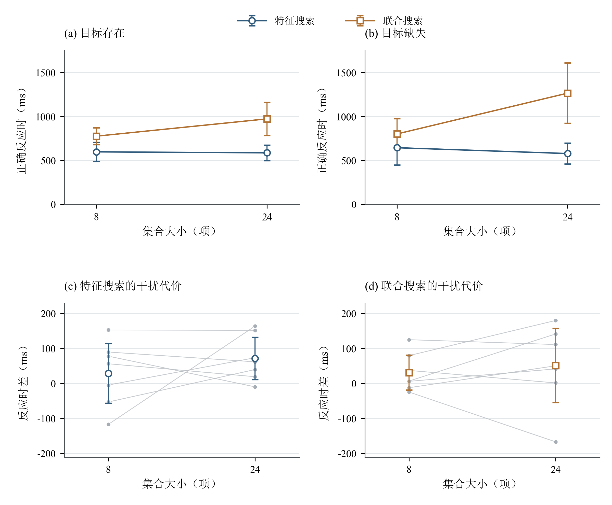
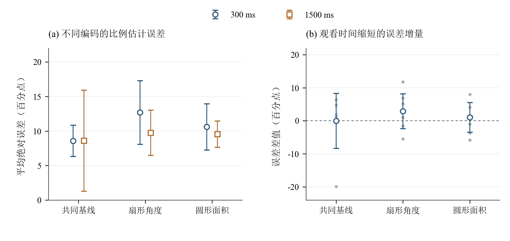
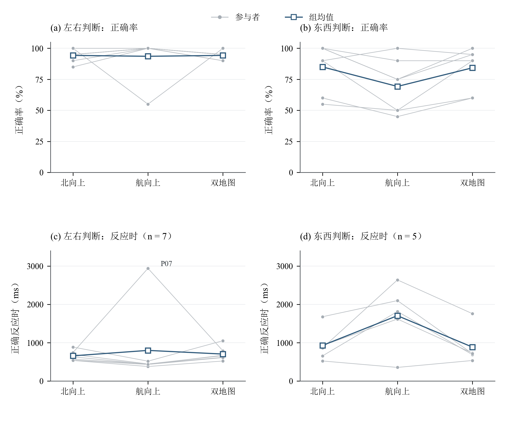

# 注意与知觉实验室

实验网址：[注意与知觉实验室](https://bnu-engpsy-fall26.github.io/WangZiyi202411061010-2/)

## 一、项目简介

本项目为工程心理学作业二，采用HTML、CSS、JavaScript和Canvas实现视觉搜索、比例估计与地图定向三个经典实验，并分别加入醒目干扰物、观看时间和双地图显示条件。三个实验对应注意选择、图形信息判断与空间参照系转换，研究界面设计如何影响信息加工效率与判断准确性。

网页包含实验介绍、知情同意、练习、正式试次、个人结果、群体数据汇总和概念演示，并提供可选的摄像头注视位置估计。研究共纳入7名参与者，均完成三个实验，共获得2380次正式试次记录。

## 二、运行环境与操作

| 项目 | 说明 |
| --- | --- |
| 实验环境 | 电脑与键盘，推荐使用Chrome或Edge；浏览器支持JavaScript、Canvas和本地文件下载 |
| 在线运行 | 打开本页顶部的实验网址 |
| 本地运行 | 在项目根目录双击`index.html`，以浏览器打开 |
| 网页技术 | HTML、CSS、JavaScript、Canvas；页面及模型使用项目内资源 |
| 摄像头眼动 | 勾选摄像头同意选项，允许浏览器访问摄像头，完成校准与验证 |
| 数据项目码 | `8QDRRP` |
| 统计环境 | Python，使用NumPy、SciPy和Matplotlib完成统计计算与绘图 |

开始实验时填写分配的匿名编号并阅读知情同意。视觉搜索使用F、J键判断目标有无；比例估计输入0—100之间的整数；地图定向使用左右方向键作答。各实验先完成练习，再进入正式试次，阶段之间可休息。完成后可在结果页下载CSV或JSON，查看个人结果及群体汇总。

## 三、总体实验方法

### 1. 设计与流程

三个实验均采用被试内设计，每名参与者完成全部条件。正式试次总数为340次，练习另计；每个条件组合包含10次正式试次。

| 实验 | 因素与水平 | 条件组合数 | 正式试次 | 练习试次 |
| --- | --- | ---: | ---: | ---: |
| 视觉搜索 | 搜索方式2×醒目干扰2×集合大小2×目标状态2 | 16 | 160 | 4 |
| 比例估计 | 图形编码3×观看时间2 | 6 | 60 | 6 |
| 地图定向 | 地图显示3×判断任务2×航向偏差2 | 12 | 120 | 12 |

实验顺序及部分分块顺序按匿名编号平衡，阶段内随机呈现。每次试次重新生成图形或地图，记录条件、刺激参数、回答、反应时与正确性。练习提供反馈，正式记录用于统计分析。页面失焦、切换标签或窗口尺寸变化时中断当前呈现，并重新安排该试次。

### 2. 指标与统计

反应时使用`performance.now()`计时。视觉搜索和地图定向以正确且反应时不低于150 ms的试次计算个人条件中位数，再汇总组均值；正确率以全部正式试次为分母，超时计为错误。

比例估计的平均绝对误差定义为`平均值（|估计比例－真实比例|）`，单位为百分点。例如，真实比例为40%、回答为50%时，绝对误差为10个百分点。程序同时计算有符号偏差及`log₂（绝对误差＋0.125）`，并记录实际呈现时长和图形消失后的作答时间。

条件比较先计算参与者内差值，再检验组平均差值。报告均值差、逐项95%置信区间和双侧t检验；同一实验内的多重比较采用Holm法校正，显著性水平为0.05。以下p_Holm均表示校正后的p值。研究预测沿用数据收集前的版本。

## 四、实验一：视觉搜索

### 1. 经典范式与研究问题

Treisman与Gelade（1980）的特征整合理论区分了单一特征搜索与联合特征搜索。目标凭借单一特征即可与干扰物区分时，搜索通常较少受到集合大小影响；目标需要由颜色、形状等特征共同定义时，集合大小对搜索反应时的影响更明显。

本实验的目标始终为红色圆环。特征搜索中，目标可通过颜色与蓝色干扰物区分；联合搜索中，红色菱形和蓝色圆环分别共享目标的颜色或形状，需要结合两种特征识别目标。经典比较关注两种搜索方式的反应时及搜索斜率。

新增条件参考Theeuwes（1992）关于醒目干扰物的研究，将一个蓝色圆形干扰物改为黄色，保持其位置和形状。研究问题为：**搜索难度如何影响与任务无关的醒目干扰物所造成的干扰代价？**

### 2. 实验设计与预测

实验包含特征／联合搜索、有／无黄色干扰物、8／24项集合大小和目标存在／缺失四个因素，共16个条件、160次正式试次。参与者判断红色圆环是否存在，有目标按F，无目标按J；单次作答时限为4500 ms。

预期联合搜索的搜索斜率和醒目干扰代价更大，24项条件的干扰代价高于8项条件。搜索斜率定义为`（24项反应时－8项反应时）／16`；干扰代价为有醒目干扰与无醒目干扰条件的反应时差，并对目标存在、缺失条件等权平均。

### 3. 结果

视觉搜索共获得1120次正式试次，总体正确率为91.96%。无醒目干扰条件下，联合搜索反应时随集合大小增加而上升，特征搜索的变化较小。

| 搜索方式 | 目标状态 | 8项反应时（ms） | 24项反应时（ms） | 搜索斜率（ms/项） |
| --- | --- | ---: | ---: | ---: |
| 特征搜索 | 存在 | 598.3 | 586.9 | −0.71 |
| 特征搜索 | 缺失 | 645.3 | 579.1 | −4.13 |
| 联合搜索 | 存在 | 776.4 | 973.2 | 12.30 |
| 联合搜索 | 缺失 | 801.4 | 1265.8 | 29.02 |

7名参与者在两种目标状态下的联合搜索斜率均高于特征搜索。目标缺失时，斜率差为33.16 ms/项，95% CI [15.90, 50.42]，p_Holm＝0.027；目标存在时，斜率差为13.01 ms/项，95% CI [4.71, 21.31]，p_Holm＝0.060。

| 搜索方式 | 8项干扰代价（ms） | 24项干扰代价（ms） |
| --- | ---: | ---: |
| 特征搜索 | 29.14 | 71.71 |
| 联合搜索 | 31.36 | 51.57 |

24项相较于8项的干扰代价增加31.39 ms，95% CI [−53.97, 116.76]；联合搜索相较于特征搜索的干扰代价差为−8.96 ms，95% CI [−106.94, 89.01]。两项比较的p_Holm均为1.000。



**图1　视觉搜索反应时与醒目干扰代价。**（a、b）无醒目干扰条件下目标存在与缺失时的组平均反应时；（c、d）两种搜索方式的干扰代价。空心标记表示7名参与者的组均值，误差线表示基于参与者间变异计算的均值95%置信区间；灰色点及连线表示个人数据，虚线表示零差值。

### 4. 讨论

搜索斜率的方向与经典研究一致，目标缺失时的方式差异在多重比较校正后达到显著水平。联合搜索对集合大小更敏感，支持颜色与形状联合判断需要更多搜索加工的解释。

新增条件的四种平均干扰代价均为正值，但效应随参与者变化较大。24项的干扰代价较大，与预测方向一致；联合搜索的平均干扰代价略低于特征搜索，与预测方向相反。因此，当前结果对“搜索越困难，醒目干扰代价越大”的预测提供有限支持。

## 五、实验二：比例估计

### 1. 经典范式与研究问题

Cleveland与McGill（1984）的图形知觉研究比较了人们从不同视觉编码中读取数量关系的准确性。本实验要求估计B的数值占A的百分比，使用共同基线、扇形角度和圆形面积三种编码：分别通过柱形高度、扇形大小和圆面积表达数值。

经典比较关注同一类比例判断在不同图形编码中的误差。新增条件将观看时间设为300 ms与1500 ms，图形消失后再输入估计值。研究问题为：**观看时间缩短后，不同图形编码的准确性优势是否发生变化？**

### 2. 实验设计与预测

实验采用3种图形编码×2种观看时间的设计，共60次正式试次。各参与者的60个比例真值互不重复，各条件覆盖相同比例区间且真值均值一致；图形位置、大小和排列随试次变化。参与者输入0—100之间的整数，作答时限从图形消失后开始计算，为12000 ms。

预期共同基线的估计误差较小，短时观看使角度、面积编码的误差增加更多。短时误差增量定义为300 ms条件减去1500 ms条件的误差；进一步比较各编码的增量，以检验编码与观看时间的交互作用。

### 3. 结果

比例估计共获得420次完整数值回答，总体平均绝对误差为9.96个百分点。共同基线在两种观看时间下的平均误差均最低。

| 图形编码 | 300 ms误差（百分点） | 1500 ms误差（百分点） | 短时误差增量（百分点） |
| --- | ---: | ---: | ---: |
| 共同基线 | 8.59 | 8.60 | −0.01 |
| 扇形角度 | 12.69 | 9.74 | 2.94 |
| 圆形面积 | 10.60 | 9.56 | 1.04 |

1500 ms条件下，扇形角度相较于共同基线的误差差为1.14个百分点，圆形面积相较于共同基线为0.96个百分点，两项比较的p_Holm均为1.000。

相对于共同基线，角度编码的短时误差增量为2.96个百分点，95% CI [−3.48, 9.40]；面积编码的相应增量为1.06个百分点，95% CI [−8.71, 10.83]。两项交互比较的p_Holm均为1.000。

实际平均呈现时长分别为309.54 ms和1509.82 ms。图形消失后的作答时间分别为2521.05 ms和1865.33 ms，数值为个人条件中位数经编码条件等权平均后的组均值。



**图2　比例估计误差与观看时间效应。**（a）各编码在两种观看时间下的平均绝对误差；（b）个人短时误差增量，即“300 ms误差－1500 ms误差”。空心标记表示7名参与者的组均值，误差线表示均值95%置信区间；灰色点表示个人差值，虚线表示零差值。

### 4. 讨论

共同基线的描述性优势与经典图形知觉研究相符。短时观看条件下，扇形角度的误差增量较大，方向上符合时间压力对不同编码产生不同影响的预测，但交互效应的置信区间较宽。

共同基线的个人结果显示，6名参与者在短时条件下的误差较大，P01的短时误差则低19.90个百分点，使组平均增量接近0。该条件的个人增量中位数为1.90个百分点。均值与个人分布共同表明，观看时间效应存在较大的个体差异。

## 六、实验三：地图定向

### 1. 经典范式与研究问题

北向上地图保持地理北方位于屏幕上方；航向上地图随运动方向旋转，使机头始终朝上。Aretz（1991）讨论了两种显示与导航参照系的关系：稳定的地理朝向有利于维持空间关系，与运动方向对齐的显示有利于自身视角判断。

本实验同时设置左右判断与东西判断。左右判断要求以无人机自身朝向为参照，判断目的地位于机头左侧还是右侧；东西判断要求以地理方向为参照，判断目的地相对无人机位于东侧还是西侧。

新增显示为“北向上主地图＋航向上小地图”，同时提供地理参照与自身朝向参照。研究问题为：**地图参照系与任务参照系如何匹配，双地图能否改善单一显示在不匹配任务中的表现？**

### 2. 实验设计与预测

实验采用3种地图显示×2种判断任务×2种航向偏差的设计，共120次正式试次。地图显示包括北向上、航向上和双地图；航向偏差为30°与120°，正负航向与答案方向平衡。地图道路、目标位置和背景随试次变化。

左右判断中，左侧按←、右侧按→；东西判断中，西侧按←、东侧按→。单次作答时限为5000 ms。预期航向上更适合左右判断，北向上更适合东西判断，双地图改善各自不匹配任务的表现。

### 3. 结果

地图定向共获得840次正式试次，其中729次正确、5次超时，总体正确率为86.79%。对30°与120°条件等权平均后，左右判断在三种显示中的正确率接近；东西判断在北向上与双地图条件下的正确率较高。

| 地图显示 | 左右判断正确率 | 东西判断正确率 |
| --- | ---: | ---: |
| 北向上 | 94.3% | 85.0% |
| 航向上 | 93.6% | 69.3% |
| 双地图 | 94.3% | 84.3% |

东西判断中，双地图相较于航向上的正确率增加15.00个百分点，相较于北向上的差值为−0.71个百分点。上述正确率比较为描述性结果。

左右判断中，6名参与者使用航向上地图反应较快，“北向上－航向上”个人反应时差的中位数为157.75 ms。P07在航向上条件下反应较慢，使7人的平均差值为−141.71 ms，95% CI [−983.44, 700.01]，p_Holm＝1.000。

P03和P05在“航向上、东西判断、120°”条件下的10次试次均回答错误，涉及该条件的配对反应时比较基于其余5名具有完整正确反应时的参与者。两人的错误均计入正确率。上述5人的东西判断反应时分别为北向上927.90 ms、航向上1703.90 ms和双地图884.60 ms。

双地图相较于航向上平均缩短819.30 ms，95% CI [79.48, 1559.12]，原始p＝0.037，p_Holm＝0.260。左右判断中，双地图相较于北向上平均延长45.93 ms，p_Holm＝0.538；地图朝向与任务类型的反应时交互差为472.50 ms，p_Holm＝0.828。



**图3　地图定向的正确率与反应时。**（a、b）7名参与者在两种任务中的正确率；（c）7名参与者在左右判断中的正确反应时；（d）5名具有完整正确反应时的参与者在东西判断中的表现。各指标均对30°与120°条件等权平均。灰色点及连线表示个人数据，蓝色空心方形及连线表示组均值。

### 4. 讨论

东西判断的描述性结果支持保持地理参照的北向上显示，双地图也呈现接近北向上的正确率。与航向上相比，双地图在该任务中的反应时较短，方向上符合新增显示改善不匹配任务的预测。

左右判断中，多数参与者使用航向上地图更快，但整体均值受到P07较长反应时的影响。双地图在左右判断中的平均反应时略长于北向上，其优势表现出任务依赖性。结合多重比较校正结果，新增显示的效应仍具有较大不确定性。

## 七、摄像头注视位置估计

眼动模块采用本地部署的WebGazer 3.5.3。参与者单独同意摄像头使用后，完成九点校准，每点点击5次，再进行四点验证；验证通过后采集实验期间的注视位置估计。视频在浏览器内处理，上传数据为屏幕区域采样计数、样本量和校准质量。

P02、P03和P06共获得7372个样本，覆盖1019个正式试次。

| 参与者 | 视觉搜索样本数 | 比例估计样本数 | 地图定向样本数 | 校准中位误差（px） |
| --- | ---: | ---: | ---: | --- |
| P02 | 996 | 573 | 1179 | 100／112 |
| P03 | 1317 | 570 | 635 | 100／112 |
| P06 | 948 | 525 | 629 | 164 |

该部分提供行为结果之外的注视采样记录。平台保存左部、中部、右部及区域外的采样计数，本次报告汇总样本数量与校准质量。

## 八、综合讨论与结论

三个实验分别考察了搜索特征、图形编码和地图参照系与任务表现之间的关系。经典视觉搜索效应的方向最一致，目标缺失条件下的搜索斜率差达到校正后的显著性水平。比例估计中共同基线的平均误差最低，地图定向中保持地理参照的显示在东西判断中的描述性表现较好，均与相应经典研究的方向相符。

新增条件的结果显示：醒目干扰代价随搜索条件及参与者变化；短时观看对角度编码的平均误差影响较大；双地图的描述性改善主要出现在东西判断。三项研究预测均得到实际数据检验，但新增效应的估计精度有限。

研究样本为7人，每个条件包含10次试次。比例估计与地图反应时均出现明显个体差异，部分地图条件缺少正确反应时，使相关配对比较的有效样本为5人。因此，结果解释以个人分布、正确率、配对效应及其置信区间为依据，后续可增加参与者和条件内试次数，提高估计精度。

完整统计检验、个人总体表现和主要配对效应见[结果报告](results/结果分析.md)及[统计汇总](results/statistics-seven.json)。本次分析固定使用P01—P07数据，数据快照读取时间为2026年11月8日18:03（北京时间）。

## 九、文件结构与数据保存

```text
注意实验室/
├── index.html                 实验入口
├── README.md                  实验设计、结果与讨论
├── assets/                    页面样式、实验逻辑、绘图与眼动资源
├── results/                   正式结果报告、图表与统计汇总
├── tests/                     实验设计与资源校验脚本
└── tools/                     统计绘图与眼动资源打包脚本
```

各实验结束后自动向课程平台提交正式记录，提交失败时可重试；同时支持下载CSV或JSON保存。结果页支持读取项目数据及导入记录，展示条件汇总和配对效应。

本次统计与绘图代码为`tools/analyze-seven.py`，使用本地固定数据快照进行复核。原始记录保存在课程平台项目`8QDRRP`，本地快照位于`data.private/`。

## 十、参考文献

1. Treisman, A. M., & Gelade, G. (1980). A feature-integration theory of attention. *Cognitive Psychology, 12*(1), 97–136. [DOI](https://doi.org/10.1016/0010-0285(80)90005-5)
2. Theeuwes, J. (1992). Perceptual selectivity for color and form. *Perception & Psychophysics, 51*, 599–606. [DOI](https://doi.org/10.3758/BF03211656)
3. Cleveland, W. S., & McGill, R. (1984). Graphical perception: Theory, experimentation, and application to the development of graphical methods. *Journal of the American Statistical Association, 79*(387), 531–554. [DOI](https://doi.org/10.1080/01621459.1984.10478080)
4. Aretz, A. J. (1991). The design of electronic map displays. *Human Factors, 33*(1), 85–101. [DOI](https://doi.org/10.1177/001872089103300107)

## 十一、AI使用说明

AI辅助编程；作者负责实验实施、统计计算、图表制作与文字整理。
