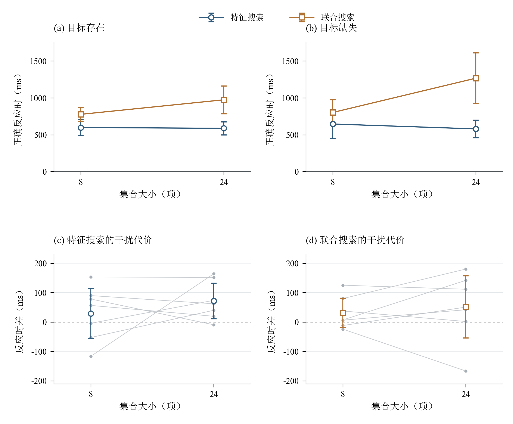
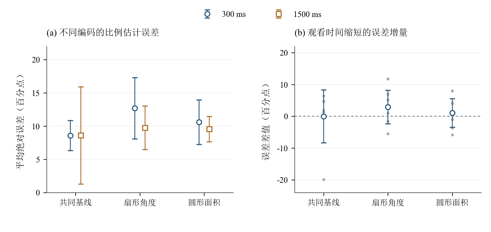
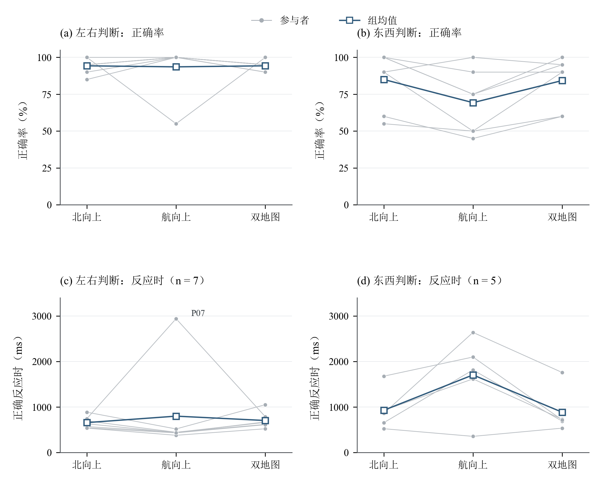

# 注意与知觉实验结果报告

## 1　样本与统计方法

本研究纳入7名参与者（P01—P07）的21份完整实验记录，共2380次正式试次，包括视觉搜索1120次、比例估计420次和地图定向840次。各参与者均完成全部实验，每个条件组合包含10次正式试次。

反应时以参与者为统计单位。视觉搜索与地图定向采用正确且反应时不低于150 ms的试次，计算个人各条件反应时中位数，再汇总组均值。正确率包含全部正式试次，超时计为错误。比例估计的平均绝对误差以全部有效数值回答计算，单位为百分点。

条件效应先在参与者内计算差值，再进行双侧单样本 *t* 检验，并报告均值差及95%置信区间。同一实验内的多重比较采用Holm法校正，显著性水平设为0.05。搜索、比例与地图实验分别包含8项、7项和7项比较。文中置信区间均为逐项区间，校正后的 *p* 值以 *p*Holm 表示。

## 2　视觉搜索

### 2.1　搜索方式与集合大小

视觉搜索的总体正确率为91.96%，共90次错误，全部试次均在时限内完成。无醒目干扰条件下，联合搜索反应时随集合大小增加而上升，特征搜索的反应时变化较小（图1a、1b）。

**表1　无醒目干扰条件下的搜索表现**

| 搜索方式 | 目标状态 | 8项反应时（ms） | 24项反应时（ms） | 搜索斜率（ms/项） |
| --- | --- | ---: | ---: | ---: |
| 特征搜索 | 存在 | 598.3 | 586.9 | −0.71 |
| 特征搜索 | 缺失 | 645.3 | 579.1 | −4.13 |
| 联合搜索 | 存在 | 776.4 | 973.2 | 12.30 |
| 联合搜索 | 缺失 | 801.4 | 1265.8 | 29.02 |

目标缺失条件下，联合搜索与特征搜索的斜率差为33.16 ms/项，95% CI [15.90, 50.42]，*t*(6)&nbsp;=&nbsp;4.70，*p*Holm&nbsp;=&nbsp;.027。目标存在条件下，斜率差为13.01 ms/项，95% CI [4.71, 21.31]，*t*(6)&nbsp;=&nbsp;3.84，*p*Holm&nbsp;=&nbsp;.060。7名参与者在两种目标状态下均表现出较高的联合搜索斜率。

### 2.2　醒目干扰物效应

干扰代价定义为有醒目干扰条件与无醒目干扰条件的个人反应时差，并对目标存在、缺失条件等权平均。四种条件的平均干扰代价均为正值（表2；图1c、1d）。

**表2　不同搜索条件下的平均干扰代价（ms）**

| 搜索方式 | 8项 | 24项 |
| --- | ---: | ---: |
| 特征搜索 | 29.14 | 71.71 |
| 联合搜索 | 31.36 | 51.57 |

24项相较于8项的干扰代价增加31.39 ms，95% CI [−53.97, 116.76]，*p*Holm&nbsp;=&nbsp;1.000。联合搜索相较于特征搜索的干扰代价差为−8.96 ms，95% CI [−106.94, 89.01]，*p*Holm&nbsp;=&nbsp;1.000。集合大小效应与预测方向一致，搜索方式效应与预测方向相反，两项比较均显示较大的估计不确定性。

**图1　视觉搜索反应时与醒目干扰代价。**（a、b）无醒目干扰条件下，目标存在与缺失时的组平均反应时；（c、d）特征搜索与联合搜索的干扰代价。空心标记表示7名参与者的组均值，误差线表示基于参与者间变异计算的均值95%置信区间；灰色点及连线表示个人数据。干扰代价为“有干扰－无干扰”，虚线表示零差值。

## 3　比例估计

比例估计的420次试次均获得完整数值回答，总体平均绝对误差为9.96个百分点。共同基线在两种观看时间下的平均误差均低于扇形角度和圆形面积编码（表3；图2a）。

**表3　图形编码与观看时间对比例估计误差的影响（百分点）**

| 图形编码 | 300 ms | 1500 ms | 短时误差增量 |
| --- | ---: | ---: | ---: |
| 共同基线 | 8.59 | 8.60 | −0.01 |
| 扇形角度 | 12.69 | 9.74 | 2.94 |
| 圆形面积 | 10.60 | 9.56 | 1.04 |

1500 ms条件下，扇形角度相较于共同基线的误差差为1.14个百分点，95% CI [−5.30, 7.59]；圆形面积相较于共同基线的误差差为0.96个百分点，95% CI [−6.28, 8.19]。两项比较的 *p*Holm&nbsp;=&nbsp;1.000。

观看时间由1500 ms缩短至300 ms时，扇形角度的平均误差增加2.94个百分点，圆形面积增加1.04个百分点。相对于共同基线，角度编码的短时误差增量为2.96个百分点，95% CI [−3.48, 9.40]，*p*Holm&nbsp;=&nbsp;1.000；面积编码的相应增量为1.06个百分点，95% CI [−8.71, 10.83]，*p*Holm&nbsp;=&nbsp;1.000。

共同基线条件存在较大的个体差异（图2b）。6名参与者在300 ms条件下的误差较大，P01则在该条件下比1500 ms条件低19.90个百分点。个人短时误差增量的中位数为1.90个百分点，组均值为−0.01个百分点。

300 ms与1500 ms条件的实际平均呈现时长分别为309.54 ms和1509.82 ms。图形消失后的作答时间分别为2521.05 ms和1865.33 ms，数值为个人条件中位数经编码条件等权平均后的组均值。

**图2　比例估计误差与观看时间效应。**（a）两种观看时间下各图形编码的平均绝对误差；（b）个人短时误差增量，定义为“300 ms误差－1500 ms误差”。空心标记表示7名参与者的组均值，误差线表示均值95%置信区间；灰色点表示个人差值，虚线表示零差值。

## 4　地图定向

### 4.1　正确率

地图定向共获得840次作答，其中729次正确、5次超时，总体正确率为86.79%。对30°与120°航向偏差等权平均后，左右判断在三种显示方式下的正确率接近；东西判断在北向上和双地图条件下的正确率高于航向上条件（表4；图3a、3b）。

**表4　不同地图显示方式下的平均正确率**

| 地图显示方式 | 左右判断 | 东西判断 |
| --- | ---: | ---: |
| 北向上 | 94.3% | 85.0% |
| 航向上 | 93.6% | 69.3% |
| 双地图 | 94.3% | 84.3% |

东西判断中，双地图相较于航向上的正确率增加15.00个百分点，相较于北向上的正确率差为−0.71个百分点。上述正确率比较为描述性结果。

### 4.2　反应时

左右判断中，6名参与者在航向上条件下反应较快。个人“北向上－航向上”反应时差的中位数为157.75 ms；P07在航向上条件下反应较慢，使组平均差值为−141.71 ms，95% CI [−983.44, 700.01]，*p*Holm&nbsp;=&nbsp;1.000（图3c）。

P03和P05在“航向上、东西判断、120°”条件下的10次试次均回答错误，涉及该条件的配对反应时比较基于其余5名具有完整正确反应时的参与者。两人的错误记录均计入正确率。

在上述5名参与者中，东西判断的平均反应时分别为北向上927.90 ms、航向上1703.90 ms和双地图884.60 ms（图3d）。双地图相较于航向上平均缩短819.30 ms，95% CI [79.48, 1559.12]，*t*(4)&nbsp;=&nbsp;3.07，原始 *p*&nbsp;=&nbsp;.037，*p*Holm&nbsp;=&nbsp;.260。精确符号翻转检验的 *p* 值为 .125。

左右判断中，双地图相较于北向上平均延长45.93 ms，95% CI [−13.52, 105.37]，*p*Holm&nbsp;=&nbsp;.538。地图朝向与任务类型的反应时交互差为472.50 ms，95% CI [−399.67, 1344.67]，*p*Holm&nbsp;=&nbsp;.828。

**图3　地图定向的正确率与反应时。**（a、b）7名参与者在左右判断和东西判断中的正确率；（c）7名参与者在左右判断中的正确反应时；（d）5名具有完整正确反应时的参与者在东西判断中的表现。各指标均对30°与120°条件等权平均。灰色点及连线表示个人数据，蓝色空心方形及连线表示组均值。P07在图3c中标注。

## 5　眼动记录

P02、P03和P06获得摄像头估计的注视位置样本，共7372个，覆盖1019个正式试次。各实验的样本量及校准误差见表5。

**表5　摄像头注视位置估计的样本量与校准质量**

| 参与者 | 视觉搜索样本数 | 比例估计样本数 | 地图定向样本数 | 校准中位误差（px） |
| --- | ---: | ---: | ---: | --- |
| P02 | 996 | 573 | 1179 | 100／112 |
| P03 | 1317 | 570 | 635 | 100／112 |
| P06 | 948 | 525 | 629 | 164 |

平台记录包含屏幕左部、中部、右部及区域外的采样计数，可用于区域分布的补充描述。该部分分析范围限于采样数量与校准质量。

## 6　讨论与结论

视觉搜索结果呈现了稳定的方向一致性：7名参与者的联合搜索斜率均高于特征搜索，目标缺失条件下的斜率差在多重比较校正后达到显著水平。该结果与[Treisman与Gelade（1980）](https://doi.org/10.1016/0010-0285(80)90005-5)关于特征搜索与联合搜索差异的经典发现相符。

比例估计中，共同基线的组平均误差最低，描述性结果与[Cleveland与McGill（1984）](https://doi.org/10.1080/01621459.1984.10478080)提出的共同尺度位置判断优势相符。角度编码呈现较大的短时误差增量，但编码与观看时间交互效应的置信区间较宽，该预测的统计证据有限。

地图定向中，北向上与双地图在东西判断中的描述性表现较好，与[Aretz（1991）](https://doi.org/10.1177/001872089103300107)所讨论的地图参照系与任务需求之间的关系相符。左右判断的反应时存在明显个体差异，东西判断的完整配对反应时样本为5人；双地图效应的解释需结合正确率、个人分布和配对检验结果。

总体而言，本研究较清楚地再现了经典视觉搜索效应。醒目干扰、观看时间和双地图条件的新增效应在当前样本中表现出较大的个体差异，其效应方向及估计精度仍需更大样本进一步检验。

## 附录A　参与者总体表现

| 编号 | 搜索正确率 | 比例平均绝对误差（百分点） | 地图正确率 |
| --- | ---: | ---: | ---: |
| P01 | 96.2% | 12.40 | 95.8% |
| P02 | 86.9% | 11.15 | 95.8% |
| P03 | 96.2% | 7.35 | 74.2% |
| P04 | 90.0% | 10.77 | 94.2% |
| P05 | 98.1% | 7.32 | 86.7% |
| P06 | 80.6% | 12.03 | 73.3% |
| P07 | 95.6% | 8.72 | 87.5% |

## 附录B　主要配对比较

区间为均值差的95%置信区间；p为实验内Holm校正值。搜索斜率差单位为毫秒/项，比例误差差单位为百分点，其余为毫秒。

| 效应 | 人数 | 平均差 | 95% CI | 校正 *p* |
| --- | ---: | ---: | --- | ---: |
| 无醒目干扰：联合 − 特征的斜率 · 有目标 | 7 | 13.01 | [4.71, 21.31] | .060 |
| 无醒目干扰：联合 − 特征的斜率 · 无目标 | 7 | 33.16 | [15.90, 50.42] | .027 |
| 干扰代价：联合搜索 − 特征搜索 | 7 | -8.96 | [-106.94, 89.01] | 1.000 |
| 干扰代价：24项 − 8项 | 7 | 31.39 | [-53.97, 116.76] | 1.000 |
| 短时误差增量：角度 − 共同基线 | 7 | 2.96 | [-3.48, 9.40] | 1.000 |
| 短时误差增量：面积 − 共同基线 | 7 | 1.06 | [-8.71, 10.83] | 1.000 |
| 地图朝向效应：左右任务 − 东西任务 | 5 | 472.50 | [-399.67, 1344.67] | .828 |
| 左右判断：北向上 − 双地图 | 7 | -45.93 | [-105.37, 13.52] | .538 |
| 东西判断：航向上 − 双地图 | 5 | 819.30 | [79.48, 1559.12] | .260 |

